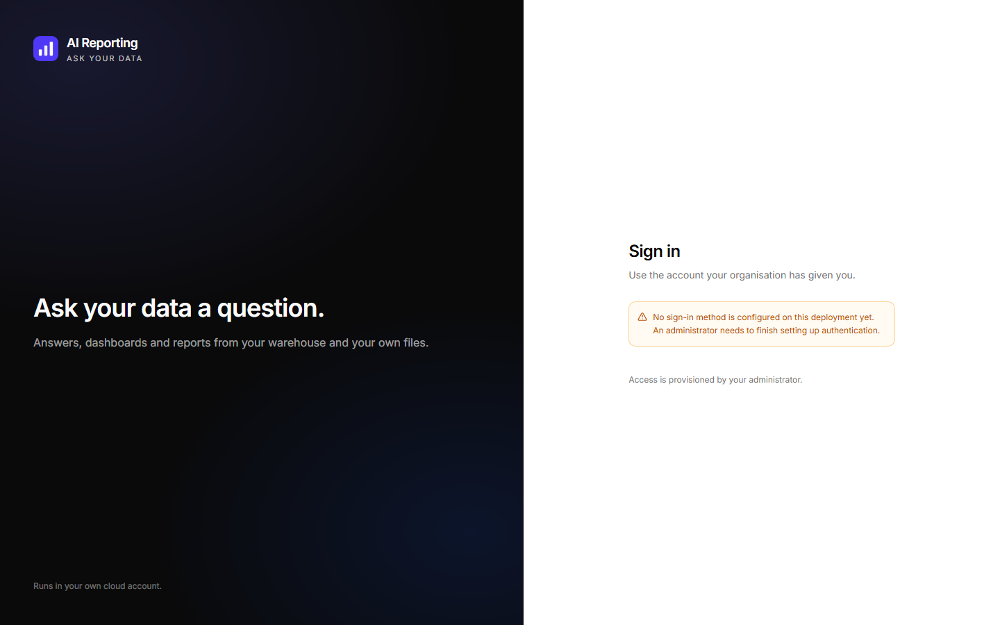
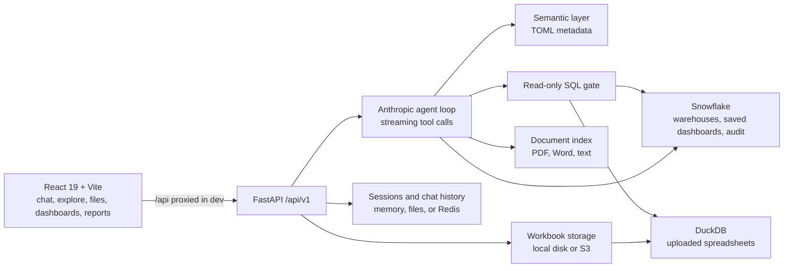
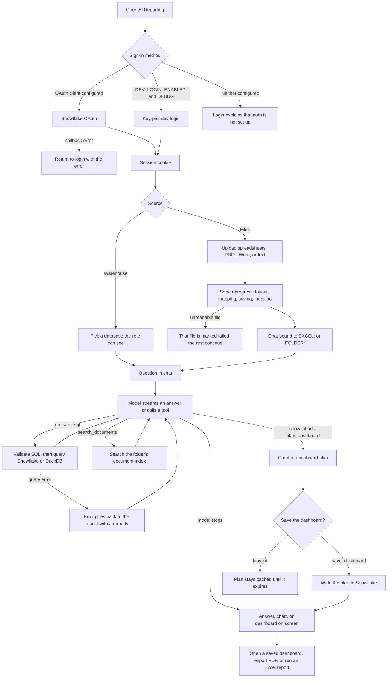

# AI Reporting

Ask questions of a Snowflake warehouse or uploaded files, then turn the answers into charts, dashboards, and Excel reports. The analyst chat is a streaming tool-calling loop on Anthropic. Numbers come from SQL, not from the model inventing them.



## Demo

Hosted development: [https://one-dev.dataalpha.in/login](https://one-dev.dataalpha.in/login)

That environment is the current deployment. Sign-in is email and password, or **Continue with Snowflake**. The live tab title is still DataAlphaOne; the AI Reporting name in this working tree is not on that host until this branch is deployed.

## Contents

- [Demo](#demo)
- [Features](#features)
- [Screenshots](#screenshots)
- [Architecture](#architecture)
- [Workflow](#workflow)
- [Tech stack](#tech-stack)
- [Project structure](#project-structure)
- [Prerequisites](#prerequisites)
- [Installation](#installation)
- [Environment](#environment)
- [Run locally](#run-locally)
- [How to use it](#how-to-use-it)
- [Testing and troubleshooting](#testing-and-troubleshooting)
- [Security and data handling](#security-and-data-handling)
- [Limitations](#limitations)

## Features

- Sign in with Snowflake OAuth. A local key-pair login exists for development and is off unless `DEBUG` and `DEV_LOGIN_ENABLED` are both set.
- Chat against one database or one uploaded folder. The model can list tables, run read-only SQL, explain glossary terms, and draw charts.
- Upload spreadsheets (`.xlsx`, `.xlsm`, `.xls`) and documents (`.pdf`, `.docx`, `.txt`). Same-shaped workbooks become one dataset so a trend can span periods. Progress is reported from work the server has finished.
- Plan, save, edit, and rerun dashboards. Saved dashboards and their versions live in Snowflake.
- Build Excel reports from an uploaded template, with queries bound to the workbook.
- Author a semantic layer (metrics, joins, column meaning) when the signed-in Snowflake role is in `ADMIN_ROLES`.

## Screenshots

The image above is the sign-in screen from a local run (`docs/screenshots/dashboard.png`). With no OAuth client and dev login left off, that is the screen the app shows, including the message that authentication is not configured.

These screens still need a signed-in session before they can be captured. They were not mocked:

- `docs/screenshots/upload-page.png` — Files upload
- `docs/screenshots/job-progress.png` — upload progress
- `docs/screenshots/results.png` — a chat answer, chart, or dashboard
- `docs/screenshots/history.png` — conversation history in the sidebar

## Architecture



Source: [docs/architecture.mmd](docs/architecture.mmd).

The frontend talks only to `/api/v1`. In development, Vite proxies `/api` to `http://localhost:8000`. Sessions are in-process by default (`SESSION_BACKEND=memory`) and can persist dev-login sessions to `.sessions/`. Chat history defaults to `.conversations/`. Production should use Redis, because the API runs multiple workers and an in-memory session exists on only one of them.

There is no separate job queue. Upload progress is a server-sent stream from the request that is reading the files. Chat progress is server-sent events from `POST /api/v1/agent` (text deltas and a start/end pair per tool).

## Workflow



Source: [docs/workflow.mmd](docs/workflow.mmd).

The model does not walk a fixed pipeline. It chooses tools until it can answer. SQL is checked by a parser (`sqlglot`) before it runs. A tool error with `retryable: false` is not sent again in that turn. Dashboard plans are validated, then cached; saving writes a versioned row in Snowflake. Excel report templates are a separate path under `/api/v1/excel`: scan a workbook, bind areas to SQL, generate a file.

Orchestration is the agent loop in `backend/app/agent/loop.py` using the Anthropic SDK. LangGraph and LangChain are not used.

## Tech stack


| Layer | Choice |
| --- | --- |
| UI | React 19, Vite 7, TypeScript, Tailwind 4, shadcn/ui, Recharts |
| API | FastAPI, Pydantic, uvicorn |
| Model | Anthropic Messages API (`ANTHROPIC_MODEL_AGENT`, default `claude-sonnet-5`) |
| Warehouse | Snowflake connector, OAuth for users, optional key-pair for local dev |
| Files | openpyxl, xlrd, DuckDB, PyMuPDF, python-docx |
| Sessions | In-memory, file, or Redis |
| Object storage | Local directory or S3 (`EXCEL_STORAGE_BACKEND`) |

## Project structure

```
frontend/          React app
backend/           FastAPI app (app/api, app/agent, app/engine)
backend/config/    Semantic-layer TOML
docker/            Dockerfiles
docs/              Deployment notes, diagrams, screenshots
docker-compose.yml
```

API routes live under `/api/v1/`: `auth`, `databases`, `agent`, `chat` (legacy), `dashboards`, `reports`, `excel`, `excel-sources`, `admin/semantic`. Health check: `GET /health`.

## Prerequisites

- Node.js 20+ and pnpm (verified with Node 24 and pnpm 10)
- Python 3.12 and pipenv. The Pipfile pins 3.12. Python 3.14 can create the virtualenv and start the API, with a version warning from pipenv. Prefer 3.12 when it is installed.
- A Snowflake account for real sign-in and warehouse questions
- An Anthropic API key for chat, dashboard planning, and spreadsheet mapping
- Redis only when `SESSION_BACKEND=redis`

## Installation

```sh
cd backend
pipenv install

cd ../frontend
pnpm install
```

## Environment

```sh
cp backend/.env.example backend/.env
cp frontend/.env.example frontend/.env
```

Never commit `.env`. Placeholders only belong in the examples.

Backend values that matter locally:

| Variable | Purpose |
| --- | --- |
| `SNOWFLAKE_ACCOUNT`, `SNOWFLAKE_WAREHOUSE` | Warehouse connection |
| `OAUTH_CLIENT_ID`, `OAUTH_CLIENT_SECRET`, `OAUTH_REDIRECT_URI` | User login. Redirect must hit the API, default `http://localhost:8000/api/v1/auth/callback` |
| `FRONTEND_URL` | Where OAuth sends the browser back (`http://localhost:5173`) |
| `ANTHROPIC_API_KEY` | Required for chat. AI routes return 503 without it |
| `TOKEN_ENCRYPTION_KEY` | Encrypts refresh tokens. Empty generates a process-local key, which breaks multi-worker decrypt |
| `ADMIN_ROLES` | Snowflake roles allowed into the semantic editor. Empty means nobody |
| `DEV_LOGIN_ENABLED` | Local bypass. Also needs `DEBUG=true` and key-pair material |
| `SESSION_BACKEND` | `memory` locally, `redis` in production |
| `EXCEL_STORAGE_BACKEND` | `local` or `s3` |

Frontend:

| Variable | Purpose |
| --- | --- |
| `VITE_SHOW_REPORT_BUILDER` | `true` shows the Report Builder link. The route still exists when this is unset |

Snowflake OAuth setup is in [backend/README.md](backend/README.md) and [docs/SNOWFLAKE-SETUP.md](docs/SNOWFLAKE-SETUP.md). Hosted deployment is in [docs/DEPLOYMENT.md](docs/DEPLOYMENT.md).

## Run locally

Two terminals, from the repo root.

```sh
cd backend
pipenv run uvicorn app.main:app --reload --port 8000
```

```sh
cd frontend
pnpm dev
```

Open [http://localhost:5173](http://localhost:5173). Confirm the API with `GET http://localhost:8000/health` (`{"status":"ok"}`).

`docker compose` also builds the stack (`docker-compose.yml`). It expects `backend/.env` and is aimed at the same images used in deployment. Hosted dev uses `docker-compose.dev.yml`.

## How to use it

1. Sign in. If OAuth is not configured, the login page says so instead of offering a dead button.
2. Start a chat and pick a database, or open **Files**, drop a workbook, and ask from that folder once it finishes reading.
3. Read the tool rows under an answer. SQL and dashboard plans stay inside the disclosure; the row itself uses a plain-language label.
4. Save a dashboard from the chat when the plan looks right, then open it under **Dashboards**.
5. Excel template reports are under **Reports**, and the admin semantic editor opens in its own tab for roles in `ADMIN_ROLES`.

## Testing and troubleshooting

```sh
cd frontend
pnpm lint
pnpm typecheck
pnpm build

cd ../backend
pipenv run pytest
```

| Symptom | What to check |
| --- | --- |
| Login says no method is configured | `OAUTH_CLIENT_ID` / secret, or dev login flags |
| Signed in, then immediately signed out | `SESSION_BACKEND=memory` with more than one uvicorn worker. Use one worker locally or Redis |
| Chat returns 503 | `ANTHROPIC_API_KEY` |
| OAuth redirect fails | `OAUTH_REDIRECT_URI` must be the backend URL, not the Vite origin |
| Upload disappears after restart | `EXCEL_STORAGE_BACKEND=local` keeps files under the backend directory; containers need S3 or a volume |
| Admin link missing | `ADMIN_ROLES` must include the active Snowflake role |

## Security and data handling

- Queries pass a read-only SQL gate before Snowflake or DuckDB runs them. The signed-in user's Snowflake role still limits what that SQL can see.
- OAuth refresh tokens are encrypted with `TOKEN_ENCRYPTION_KEY`. Dev-login sessions may be written under `backend/.sessions/`; OAuth sessions are not written to that store.
- Chat transcripts live in `.conversations/` or Redis. Both are gitignored when using the file store.
- Do not commit `.env`, `*.p8`, `*.pem`, or private keys. `.gitignore` already excludes them.
- Audit rows are written to Snowflake and record who asked what. They are best-effort and must not block a request.
- Uploaded workbooks can contain client data. Local storage is on disk; S3 storage follows the lifecycle in [docs/EXCEL-STORAGE.md](docs/EXCEL-STORAGE.md).

## Limitations

- Warehouse questions, dashboard save, and OAuth all need a Snowflake account. This repository does not ship a demo warehouse.
- Chat, spreadsheet mapping, and dashboard planning need an Anthropic key. Without it the API still serves health checks and the login page.
- There is no web-search, LinkedIn, Apollo, or HubSpot integration in this codebase. Discovery and CRM sync are out of scope.
- Report Builder stays hidden until `VITE_SHOW_REPORT_BUILDER=true`.
- The legacy `POST /api/v1/chat` route remains for tests. The UI uses the streaming agent.
