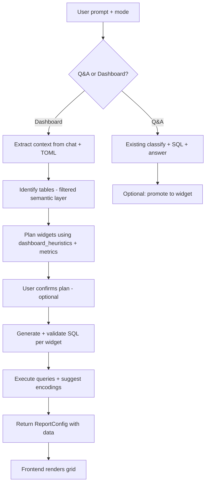

# Dashboard & Report Generation Plan

AI-generated dashboards from chat, scoped to a selected database and conversation context.

**Status:** Planning — work through phases in order.

---

## Overview

### User flow

1. **Q&A** — User explores data with natural-language questions.
2. **Dashboard** — User switches to Dashboard mode (or promotes Q&A results) to generate a structured report.
3. **Review** — User reviews the planned panels before (or after) queries run.
4. **Render** — Frontend lays out stat cards, charts, and tables from a versioned config.

### Pipeline



---

## What exists today

| Area | Current state |
|------|----------------|
| Q&A pipeline | `AIQueryService.answer()` — classify → SQL → validate → summarise |
| Chart suggestion | `_suggest_chart()` per query — uses [`chart_catalog.toml`](../backend/app/metadata/chart_catalog.toml) via `build_chart_catalog_context()` |
| Dashboard mode (frontend) | Rewrites prompt: `Build a dashboard showing: …` only |
| TOML metadata | `dashboard_heuristics`, `metrics`, `join_rules`, semantic layer |
| `dashboard_heuristics` | Defined in TOML (`loan.toml`, etc.) — **not wired into code** |
| Reports API | Placeholder (`GET /reports/sample`) |
| Frontend charts | shadcn/Recharts examples — no dynamic report renderer |

**Key files**

- `backend/app/services/ai_query.py` — Q&A + chart suggestion
- `backend/app/metadata/loader.py` — semantic layer, metrics, join rules
- `backend/app/metadata/chart_catalog.toml` — chart types + modifiers for AI (global, not per-database)
- `backend/app/metadata/configs/*.toml` — per-database heuristics
- `frontend/src/components/chat/chat-view.tsx` — dashboard mode prompt rewrite

---

## Context collection

Inputs for dashboard planning (be selective, not exhaustive):

| Input | When | Notes |
|-------|------|-------|
| User prompt | Always | Primary intent |
| TOML semantic layer | Always | **Filtered** to shortlisted tables only (`build_semantic_context(database, filter_tables=…)`) |
| Live Snowflake schema | After table shortlist | Only for identified tables |
| Q&A history | Optional | **Structured extraction**, not raw chat dump |

### Distilled chat context (target shape)

```json
{
  "intent": "delinquency dashboard for SERVICER1",
  "confirmed_tables": ["LOAN.PUBLIC.SERVICER1"],
  "prior_sql": ["SELECT ... WHERE LOAN_STATUS LIKE 'DELQ%'"],
  "user_constraints": ["by state", "last 12 months"]
}
```

---

## Report config schema (v1)

Separate **data** (SQL), **presentation** (encoding), and **layout**.

```json
{
  "version": 1,
  "title": "Loan Portfolio Overview",
  "database": "LOAN",
  "filters": [
    {
      "id": "date_range",
      "column": "AS_OF_DATE",
      "type": "date_range",
      "default": "last_12_months"
    }
  ],
  "widgets": [
    {
      "id": "kpi_delinquent_count",
      "type": "stat",
      "title": "Delinquent Loans",
      "sql": "SELECT COUNT(*) AS cnt FROM ...",
      "valueColumn": "cnt",
      "format": "number",
      "trendSql": null,
      "layout": { "colSpan": 1, "rowSpan": 1 }
    },
    {
      "id": "chart_by_state",
      "type": "bar",
      "title": "Principal by State",
      "sql": "SELECT PROPERTY_STATE, SUM(...) AS total_principal FROM ...",
      "encoding": {
        "x": "PROPERTY_STATE",
        "y": ["total_principal"]
      },
      "layout": { "colSpan": 2, "rowSpan": 1 }
    }
  ]
}
```

### Widget types

Chart `type` values and modifiers are defined in **[`backend/app/metadata/chart_catalog.toml`](../backend/app/metadata/chart_catalog.toml)**.  
`MetadataService.build_chart_catalog_context()` renders this file for LLM prompts; `_suggest_chart()` in `ai_query.py` uses it for Q&A chart selection.

| `type` | Purpose | Reference |
|--------|---------|-----------|
| `stat` | KPI / metric card | [shadcn dashboard-01](https://ui.shadcn.com/blocks#dashboard-01) section cards |
| `bar` | Category comparison | Recharts bar chart |
| `line` | Trends over time | Recharts line chart |
| `area` | Volume / trend fill | Recharts area chart |
| `pie` | Parts of a whole (few categories) | Recharts pie chart |
| `table` | Raw rows when chart is not ideal | Existing chat table component |

### Encoding

Align with existing `_suggest_chart` output: `{ type, x, y, title }` so Q&A chart suggestions can be promoted into dashboard widgets.

### API response kinds

Extend chat (or add `POST /chat/dashboard`):

| `kind` | Meaning |
|--------|---------|
| `dashboard_plan` | Widgets + SQL, no data yet (for review) |
| `dashboard_result` | Same structure with `data` filled per widget |

---

## Backend pipeline (decomposed)

Do **not** generate the full dashboard in one LLM call. Mirror the Q&A decomposition:

| Step | Action |
|------|--------|
| 1. Table shortlist | LLM picks 2–5 tables from semantic summaries (cheap model) |
| 2. Panel planning | Plan widgets using user prompt + `dashboard_heuristics` + curated `metrics` |
| 3. User confirm | Optional review before execution |
| 4. Per-panel SQL | One `_generate_sql` + validate + repair per widget |
| 5. Chart encoding | Decide after seeing column types and row shape (`_suggest_chart`) |
| 6. Execute | Run queries, attach data to config |

### Validation & safety

Reuse existing Q&A safeguards:

- `validate_sql` + `enforce_row_limit`
- One SQL repair attempt per widget on failure
- Drop or flag broken panels — do not fail the whole dashboard
- Deduplicate near-identical SQL across widgets
- Cap widget count and total rows (cost guard)
- Empty-state per widget (“No data”) instead of breaking layout

### TOML assets to wire

- `dashboard_heuristics` — panel suggestions per domain (e.g. delinquency → count + exposure)
- `metrics` — authoritative KPI definitions + SQL for stat cards
- `join_rules` — per-panel SQL generation

---

## Q&A → Dashboard handoff

| Option | Description |
|--------|-------------|
| **A** | Dashboard mode sends `chat_history` + `mode: "dashboard"` to backend |
| **B** | “Add to dashboard” on a Q&A answer — promotes query + chart into a widget |
| **C** | Dashboard mode always returns `dashboard_plan` first; user confirms execution |

**Recommendation:** Start with **B** (promote proven SQL) + **C** (plan-before-execute).

---

## Frontend

### Components (to build)

| Component | Role |
|-----------|------|
| `ReportRenderer` | Takes `ReportConfig` + data, renders grid |
| `StatCard` | KPI widget (`type: stat`) |
| `ChartWidget` | Maps `encoding.type` → Recharts wrapper |
| `TableWidget` | Reuse chat table for `type: table` |

### Layout

- Start with fixed 2-column CSS grid
- Defer drag-resize (`react-grid-layout`) until later

### Persistence (later)

- `dashboard_id` linked to chat session
- Saved report config JSON
- Refresh timestamp for live data

---

## Implementation checklist

Work through in order. Check off as completed.

### Phase 0 — Schema & types

- [ ] Define `ReportConfig` / `Widget` Pydantic models in `backend/app/schemas/`
- [ ] Define matching TypeScript types in `frontend/src/lib/api.ts`
- [ ] Document schema version (`version: 1`)

### Phase 1 — Wire existing assets

- [ ] Expose `chart` field on `ChatResponse` (backend route + frontend type)
- [ ] Add `MetadataService.get_dashboard_heuristics(database)` and use in loader if missing
- [ ] Render single chart in chat when `chart` is present (validates chart path end-to-end)

### Phase 2 — Dashboard planning (no execution)

- [ ] Add `plan_dashboard()` to `AIQueryService` (or new `DashboardService`)
- [ ] Table shortlist step with filtered `build_semantic_context`
- [ ] Panel planning prompt using `dashboard_heuristics` + `metrics`
- [ ] Return `kind: dashboard_plan` with widget list + SQL (unexecuted)
- [ ] Frontend: show plan summary in chat or dedicated panel

### Phase 3 — Dashboard execution

- [ ] Execute SQL per widget with validate/repair loop
- [ ] Attach `data` + `encoding` per widget
- [ ] Return `kind: dashboard_result`
- [ ] Handle partial failure (some widgets ok, some errored)

### Phase 4 — Frontend report renderer

- [ ] `ReportRenderer` with stat cards + charts
- [ ] Dashboard route or inline view in chat
- [ ] Empty and error states per widget

### Phase 5 — Q&A promotion & polish

- [ ] “Add to dashboard” from Q&A messages
- [ ] Optional user confirm step before execution
- [ ] Persist dashboard config (backend store or localStorage v1)
- [ ] Dashboard-level filters (date range, etc.)

---

## Original sketch (for reference)

User’s initial notes:

- Q&A, then Generate Dashboard via Dashboard option
- Collect context: user prompt, TOML schema (optional), Q&A history (optional)
- Identify tables for reporting
- Identify columns, queries, and chart types
- Generate report config (array of chart objects + stats cards)

This document expands that into a phased, schema-first plan aligned with the current codebase.
